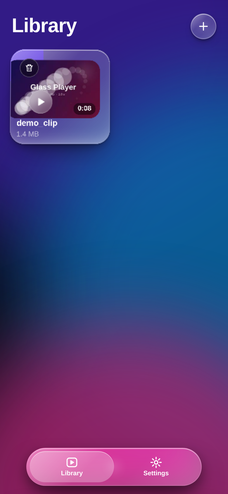
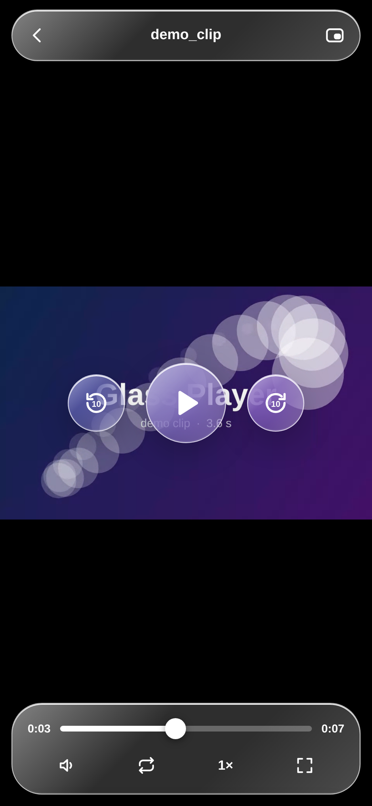
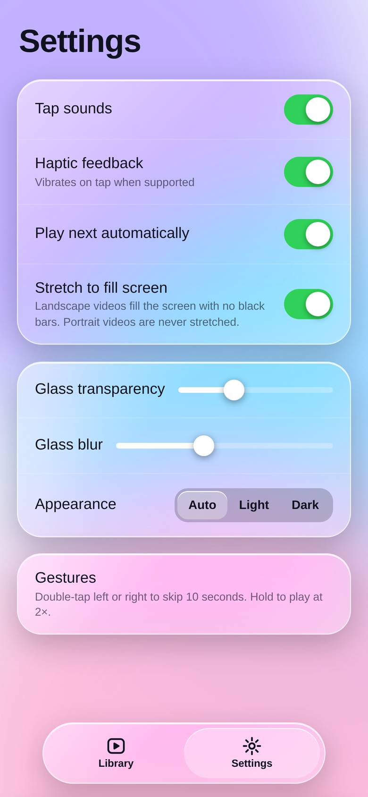
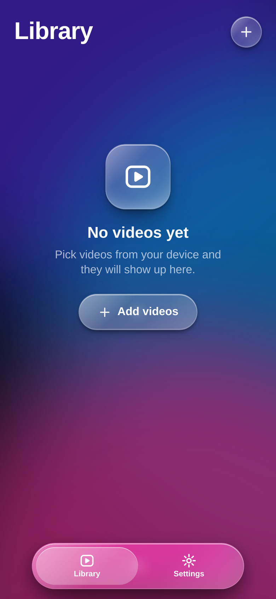
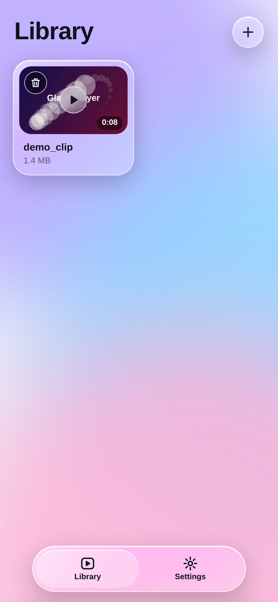
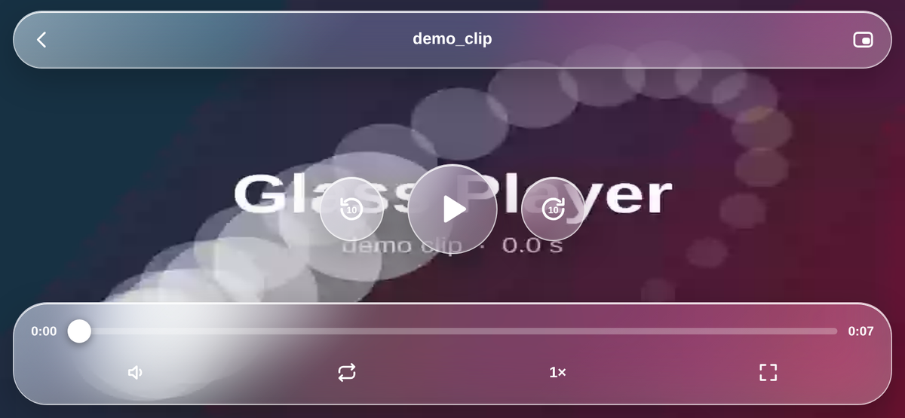

# Video Player

A glassmorphism video player for Android. Same UI as **Glass Player**, packaged as an installable APK.

Everything runs on-device and fully offline: the app declares no `INTERNET` permission at all. Your videos are picked from storage, played locally, and never leave the phone.

| Library | Player | Settings |
| :---: | :---: | :---: |
|  |  |  |

<p align="center">
  
  
</p>

<p align="center">
  
  <br><sub>Landscape video on a landscape screen: fills edge to edge, no black bars.</sub>
</p>

## Download

**[Download Video-Player.apk](https://github.com/technicalnihilist-lgtm/video-player/releases/latest/download/Video-Player.apk)** from the latest release, open it on your phone and allow "install unknown apps" when prompted.

Prefer to build from source? Every push to `main` also produces a fresh APK in the [Actions](../../actions/workflows/build-apk.yml) tab as the **Video-Player-apk** artifact.

The APK is debug-signed, which is fine for personal use and side-loading, but is not suitable for publishing on Google Play.

## Features

- **Real glass UI** — animated gradient backdrop with live `backdrop-filter` blur, adjustable transparency and blur strength
- **Your own library** — pick one or many videos from device storage; each card gets an auto-generated thumbnail and duration
- **Full gesture player** — tap to toggle controls, double-tap left/right to skip 10 s, hold for 2× speed with a ripple
- **Playback control** — scrubber, ±10 s, loop, mute, speed (0.5×–2×), picture-in-picture and native fullscreen
- **Smart framing** — a landscape video fills the screen with no black bars only while your phone is sideways; in portrait it is letterboxed at its true shape instead of being stretched into a tall frame. Portrait video is never stretched either, and a rotate hint appears if one is played in landscape
- **Remembers where you were** — playback position is restored per video; the next video plays automatically
- **Settings that stick** — tap sounds, haptics, autoplay-next, glass transparency, glass blur, Auto/Light/Dark theme, all saved in local storage
- **Undo delete** — removing a video shows an Undo toast
- **Android back button works** — it closes the player, then the sheet, then the app

## Build it yourself

Requirements: JDK 17 and the Android SDK (compileSdk 34).

```bash
git clone https://github.com/technicalnihilist-lgtm/video-player.git
cd video-player
gradle assembleDebug
# APK -> app/build/outputs/apk/debug/Video-Player-debug.apk
```

Or just open the folder in Android Studio and press Run.

## Project layout

```
app/src/main/assets/index.html            the whole Glass Player UI (HTML/CSS/JS)
app/src/main/java/com/glassplayer/app/    MainActivity - WebView shell
app/src/main/AndroidManifest.xml          launcher entry, no INTERNET permission
app/src/main/res/                         app name, theme, launcher icons
.github/workflows/build-apk.yml           CI that produces the APK
docs/screenshots/                         the screenshots above
```

The native shell is deliberately thin. It only adds the three things a WebView cannot do on its own: opening the system video picker for `Add videos`, handing fullscreen video to a real fullscreen surface, and routing the hardware back button into the page history.

## Notes and limits

- Videos are streamed from the URI the system picker returns; the app does not copy them into private storage, so a video deleted from storage will disappear from the library after a restart (the list itself is in-memory, per session).
- Picture-in-picture is requested through the browser API, which Android WebView does not expose — the app shows a friendly "not available here" toast instead of failing silently.
- Screen wake-lock while playing is requested where the WebView supports it.

## Changelog

See [CHANGELOG.md](CHANGELOG.md).

## License

MIT — see [LICENSE](LICENSE).
