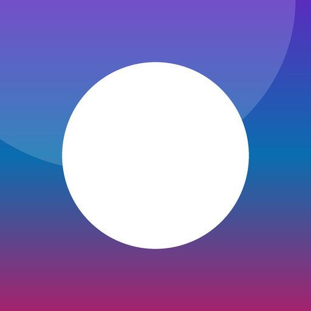

<div align="center">

<a href="https://github.com/technicalnihilist-lgtm/video-player/stargazers"></a>&nbsp;<a href="https://github.com/technicalnihilist-lgtm/video-player/network/members"></a>

<h3>Glass Player — a glassmorphism video player for Android, packaged as an APK</h3>

   

<a href="https://github.com/technicalnihilist-lgtm/video-player/releases/latest"></a>

<b>Support the work</b>

  

<sub>Donations aren't live yet — Paytm, UPI, PayPal and Buy&nbsp;Me&nbsp;a&nbsp;Coffee all show <b>coming soon</b>. Until then, a ⭐ star is the best support.</sub>

<a href="https://github.com/technicalnihilist-lgtm/video-player/releases/latest"></a>  <a href="https://github.com/technicalnihilist-lgtm/video-player/releases"></a>

<h4>Get it from</h4>

<a href="https://github.com/technicalnihilist-lgtm/video-player/releases"></a> <a href="https://github.com/technicalnihilist-lgtm/video-player/archive/refs/heads/main.zip"></a>

</div>

---

---

<p align="center"></p>

## Download

**[Download Video-Player.apk](https://github.com/technicalnihilist-lgtm/video-player/releases/latest/download/Video-Player.apk)** from the latest release, open it on your phone and allow "install unknown apps" when prompted.

Prefer to build from source? Every push to `main` also produces a fresh APK in the [Actions](../../actions/workflows/build-apk.yml) tab as the **Video-Player-apk** artifact.

The APK is debug-signed, which is fine for personal use and side-loading, but is not suitable for publishing on Google Play.

## Features

- **Depth effect** — layered shadows, a lit glass edge and cards that lift off the page, so panels read as solid glass rather than flat sheets
- **4D tilt** — cards lean toward your finger and follow the way you hold the phone, with parallax between the thumbnail, the title and a specular highlight that tracks the light; the backdrop shifts against the content as you move
- **Real glass UI** — animated gradient backdrop with live `backdrop-filter` blur, adjustable transparency and blur strength
- **Your own library** — pick one or many videos from device storage; each card gets an auto-generated thumbnail and duration
- **Full gesture player** — tap to toggle controls, double-tap left/right to skip 10 s, hold for 2× speed with a ripple
- **Playback control** — scrubber, ±10 s, loop, mute, speed (0.5×–2×), picture-in-picture and native fullscreen
- **Smart framing** — a landscape video fills the screen with no black bars only while your phone is sideways; in portrait it is letterboxed at its true shape instead of being stretched into a tall frame. Portrait video is never stretched either, and a rotate hint appears if one is played in landscape
- **Remembers where you were** — playback position is restored per video; the next video plays automatically
- **Tune the depth yourself** — three independent sliders: depth strength (shadow depth), tilt angle (how far cards lean) and parallax (how far the thumbnail, title and highlight separate), alongside the on/off switches for both effects
- **Settings that stick** — depth, tilt angle, parallax, tap sounds, haptics, autoplay-next, glass transparency, glass blur, Auto/Light/Dark theme, all saved in local storage
- **Undo delete** — removing a video shows an Undo toast
- **Android back button works** — it closes the player, then the sheet, then the app

## Build it yourself

Requirements: JDK 17 and the Android SDK (compileSdk 34).

```bash
git clone https://github.com/technicalnihilist-lgtm/video-player.git
cd video-player
gradle assembleDebug
## Project layout

```
app/src/main/assets/index.html            the whole Glass Player UI (HTML/CSS/JS)
app/src/main/java/com/glassplayer/app/    MainActivity - WebView shell
app/src/main/AndroidManifest.xml          launcher entry, no INTERNET permission
app/src/main/res/                         app name, theme, launcher icons
.github/workflows/build-apk.yml           CI that produces the APK
docs/screenshots/                         the screenshots above
```

The native shell is deliberately thin. It only adds the three things a WebView cannot do on its own: opening the system video picker for `Add videos`, handing fullscreen video to a real fullscreen surface, and routing the hardware back button into the page history.

## Notes and limits

- Videos are streamed from the URI the system picker returns; the app does not copy them into private storage, so a video deleted from storage will disappear from the library after a restart (the list itself is in-memory, per session).
- Picture-in-picture is requested through the browser API, which Android WebView does not expose — the app shows a friendly "not available here" toast instead of failing silently.
- Screen wake-lock while playing is requested where the WebView supports it.

## Changelog

See [CHANGELOG.md](CHANGELOG.md).

## License

MIT — see [LICENSE](LICENSE).

---

---

## 🌍 Languages

<sub>Donations are <b>coming soon</b> in every language below — nothing to pay today, nothing to click.</sub>

<div align="center">

<sub><b>हिन्दी · বাংলা · मराठी · తెలుగు · தமிழ் · ગુજરાતી · ಕನ್ನಡ · മലയാളം · ਪੰਜਾਬੀ · ଓଡ଼ିଆ · অসমীয়া · اردو</b></sub>

</div>

<details>
<summary><b>🌍 Open the same message in 53 languages</b></summary>

**🇮🇳 Indian languages**

- **हिन्दी** (Hindi) — ☕ जल्द ही आ रहा है। · ⭐ अगर आपको यह ऐप और हमारा काम पसंद है, तो कृपया रिपॉजिटरी को स्टार दें और हमें फॉलो करें।
- **বাংলা** (Bengali) — ☕ খুব শিগগিরই আসছে। · ⭐ যদি আপনার এই অ্যাপ এবং আমাদের কাজ ভালো লাগে, তবে অনুগ্রহ করে রিপোজিটরিটিকে একটি স্টার দিন এবং আমাদের ফলো করুন।
- **मराठी** (Marathi) — ☕ लवकरच येत आहे. · ⭐ जर तुम्हाला हे ॲप आणि आमचं काम आवडलं असेल, तर कृपया रिपॉझिटरीला स्टार द्या आणि आम्हाला फॉलो करा.
- **తెలుగు** (Telugu) — ☕ త్వరలో రాబోతోంది. · ⭐ మీకు ఈ యాప్, మా పని నచ్చితే, దయచేసి రిపోజిటరీకి ఒక స్టార్ ఇచ్చి మమ్మల్ని ఫాలో అవ్వండి.
- **தமிழ்** (Tamil) — ☕ விரைவில் வருகிறது. · ⭐ உங்களுக்கு இந்த ஆப்பும் எங்க வேலையும் பிடிச்சிருந்தா, தயவுசெஞ்சு இந்த ரெபாசிட்டரிக்கு ஒரு ஸ்டார்…
- **ગુજરાતી** (Gujarati) — ☕ ટૂંક સમયમાં આવી રહ્યું છે. · ⭐ જો તમને આ એપ અને અમારું કામ ગમતું હોય, તો પ્લીઝ રિપોઝિટરીને સ્ટાર આપો અને અમને ફોલો કરો.
- **ಕನ್ನಡ** (Kannada) — ☕ ಶೀಘ್ರದಲ್ಲೇ ಬರುತ್ತಿದೆ. · ⭐ ನಿಮಗೆ ಈ ಆ್ಯಪ್ ಮತ್ತು ನಮ್ಮ ಕೆಲಸ ಇಷ್ಟವಾದರೆ, ದಯವಿಟ್ಟು ರೆಪೊಸಿಟರಿಗೆ ಸ್ಟಾರ್ ಕೊಡಿ ಮತ್ತು ನಮ್ಮನ್ನು ಫಾಲೋ ಮಾಡಿ.
- **മലയാളം** (Malayalam) — ☕ ഉടൻ വരുന്നു. · ⭐ നിങ്ങൾക്ക് ഈ ആപ്പും ഞങ്ങളുടെ പ്രവർത്തനവും ഇഷ്ടപ്പെട്ടെങ്കിൽ, ദയവായി റെപ്പോസിറ്ററിക്ക് ഒരു സ്റ്റാർ…
- **ਪੰਜਾਬੀ** (Punjabi) — ☕ ਜਲਦੀ ਆ ਰਿਹਾ ਹੈ। · ⭐ ਜੇ ਤੁਹਾਨੂੰ ਇਹ ਐਪ ਅਤੇ ਸਾਡਾ ਕੰਮ ਪਸੰਦ ਹੈ, ਤਾਂ ਕਿਰਪਾ ਕਰਕੇ ਰਿਪੋਜ਼ਟਰੀ ਨੂੰ ਸਟਾਰ ਦਿਓ ਅਤੇ ਸਾਨੂੰ ਫਾਲੋ ਕਰੋ।
- **ଓଡ଼ିଆ** (Odia) — ☕ ଖୁବ୍ ଶୀଘ୍ର ଆସୁଛି। · ⭐ ଯଦି ଆପଣଙ୍କୁ ଏହି ଆପ୍ ଏବଂ ଆମର କାମ ଭଲ ଲାଗୁଛି, ତେବେ ଦୟାକରି ରିପୋଜିଟୋରୀକୁ ଗୋଟିଏ ଷ୍ଟାର୍ ଦିଅନ୍ତୁ ଏବଂ ଆମକୁ ଫଲୋ କରନ୍ତୁ।
- **অসমীয়া** (Assamese) — ☕ অতি সোনকালেই আহি আছে। · ⭐ যদি আপুনি এই এপটো আৰু আমাৰ কাম ভাল পায়, তেন্তে অনুগ্ৰহ কৰি ৰিপজিটৰীটোক এটা ষ্টাৰ দিয়ক আৰু আমাক ফ'ল' কৰক।
- **اردو** (Urdu) — ☕ جلد آرہا ہے۔ · ⭐ اگر آپ کو یہ ایپ اور ہمارا کام پسند آئے تو براہ کرم ریپازٹری کو سٹار دیں اور ہمیں فالو کریں۔
- **संस्कृतम्** (Sanskrit) — ☕ शीघ्रमेव आगच्छति।
- **मैथिली** (Maithili) — ☕ जल्दिये आबि रहल अछि।
- **कोंकणी** (Konkani) — ☕ रोखडेंच येता.
- **کٲشُر** (Kashmiri) — ☕ جَلدی یِوان چھُ۔
- **سنڌي** (Sindhi) — ☕ जल्द अची रह्यो आहे।
- **डोगरी** (Dogri) — ☕ जल्दी आ करदा ऐ।
- **ꯃꯤꯇꯩ ꯂꯣꯟ** (Manipuri) — ☕ ꯑꯊꯨꯕꯥ ꯃꯇꯝꯗꯥ ꯂꯥꯛꯀꯅꯤ꯫
- **बर’** (Bodo) — ☕ थाबैनो फैगोन।
- **ᱥᱟᱱᱛᱟᱲᱤ** (Santali) — ☕ ᱞᱚᱜᱚᱱ ᱦᱤᱡᱩᱜ ᱠᱟᱱᱟ᱾
- **नेपाली** (Nepali) — ☕ छिट्टै आउँदैछ। · ⭐ यदि तपाईंलाई यो एप र हाम्रो काम मन पर्‍यो भने, कृपया रिपोजिटरीलाई स्टार दिनुहोस् र हामीलाई फलो गर्नुहोस्।

**🌍 World languages**

- **العربية** (Arabic) — ☕ قريبًا. · ⭐ إذا أعجبك هذا التطبيق وعملنا، فيرجى منح المستودع نجمة ومتابعتنا.
- **简体中文** (Chinese (Simplified)) — ☕ 即将推出。
- **繁體中文** (Chinese (Traditional)) — ☕ 即將推出。
- **Čeština** (Czech) — ☕ Již brzy.
- **Dansk** (Danish) — ☕ Kommer snart.
- **Nederlands** (Dutch) — ☕ Binnenkort beschikbaar. · ⭐ Vind je deze app en ons werk leuk?
- **Filipino** (Filipino) — ☕ Malapit na.
- **Suomi** (Finnish) — ☕ Tulossa pian.
- **Français** (French) — ☕ Bientôt disponible. · ⭐ Si cette application et notre travail vous plaisent, mettez une étoile au dépôt et suivez-nous.
- **Deutsch** (German) — ☕ Bald verfügbar. · ⭐ Wenn dir diese App und unsere Arbeit gefallen, gib dem Repository einen Stern und folge uns.
- **Ελληνικά** (Greek) — ☕ Έρχεται σύντομα.
- **עברית** (Hebrew) — ☕ בקרוב.
- **Magyar** (Hungarian) — ☕ Hamarosan.
- **Bahasa Indonesia** (Indonesian) — ☕ Segera hadir. · ⭐ Jika kamu suka aplikasi ini dan karya kami, beri bintang pada repositori ini dan ikuti kami.
- **Italiano** (Italian) — ☕ In arrivo.
- **日本語** (Japanese) — ☕ 近日公開。 · ⭐ このアプリと私たちの仕事が気に入ったら、リポジトリにスターを付けてフォローしてください。
- **한국어** (Korean) — ☕ 곧 공개됩니다. · ⭐ 이 앱과 저희 작업이 마음에 드신다면 저장소에 스타를 눌러 주시고 팔로우해 주세요.
- **Bahasa Melayu** (Malay) — ☕ Akan datang.
- **Norsk** (Norwegian) — ☕ Kommer snart.
- **فارسی** (Persian) — ☕ به‌زودی.
- **Polski** (Polish) — ☕ Wkrótce. · ⭐ Jeśli podoba Ci się ta aplikacja i nasza praca, daj repozytorium gwiazdkę i obserwuj nas.
- **Português** (Portuguese) — ☕ Em breve.
- **Română** (Romanian) — ☕ În curând.
- **Русский** (Russian) — ☕ Скоро. · ⭐ Если вам нравится это приложение и наша работа, поставьте звёздочку репозиторию и подпишитесь на нас.
- **Español** (Spanish) — ☕ Muy pronto. · ⭐ Si te gusta esta app y nuestro trabajo, dale una estrella al repositorio y síguenos.
- **Kiswahili** (Swahili) — ☕ Inakuja hivi karibuni.
- **Svenska** (Swedish) — ☕ Kommer snart.
- **ไทย** (Thai) — ☕ เร็ว ๆ นี้
- **Türkçe** (Turkish) — ☕ Çok yakında.
- **Українська** (Ukrainian) — ☕ Незабаром.
- **Tiếng Việt** (Vietnamese) — ☕ Sắp ra mắt. · ⭐ Nếu bạn thích ứng dụng này và công việc của chúng tôi, hãy tặng kho lưu trữ một ngôi sao và theo…

</details>

